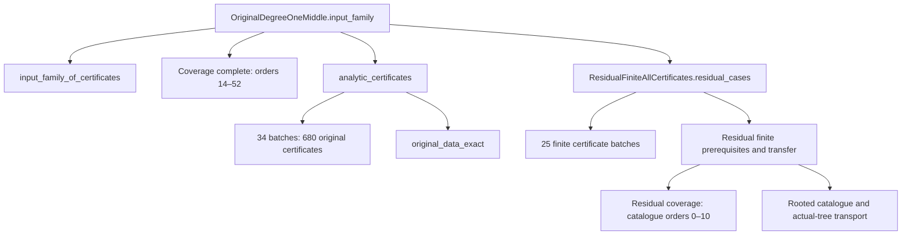

# Original degree-one Middle scope after Anchor029

## Result and limits

The next bounded original endpoint is `Proofs.RadenkovicGutmanMiddleOriginalAnchorCertificate030`. Its complete current local-source graph contains **281 modules**: **118 shared modules** with exactly the same source and recursive closure identities as the authenticated Anchor029 work, and **163 Anchor030-specific modules**. The 91 completed-module rows in the historical Anchor030 native job log match the current source and recursive closure identities exactly. If the parent authenticates their actual compiled objects and inherited evidence, the continuation frontier is **72 modules**, rather than all 163 Anchor030-specific modules.

The complete original Middle endpoint remains `Gebendorfer.RadenkovicGutman.OriginalDegreeOneMiddle.input_family`. Its source already supplies a concrete proof body. It assembles **680 original analytic anchor certificates in 34 batches**, the **39 order-coverage modules for 14 through 52**, and a separate **25-batch finite-residual certificate chain**. Anchor030 is one required certificate in batch01; completing it does not by itself close this family.

This note is source analysis, not a new kernel or archive authentication. It does not reauthenticate Large or Anchor029, open an artifact ZIP, restore proof objects, run Lean/Lake, or claim that Middle is complete. The exact assembly map records its transitive boundary explicitly. All 281 sources of the bounded Anchor030 endpoint are captured; the full transitive source graph of all 680 Middle certificates is not captured by this note.

## Source identity

- Repository: `RhudeJJJJ/formal-conjectures`.
- Branch supplied by the parent: `rg-degree-one-large-20261103`.
- Current pinned source commit: `eec9bfa2996116bb5f83fc2b6d83d015b5786c6b`.
- Current `Proofs/RG_Lean_20261019/Proofs` Git tree: `b2aed82cbb58530a1adffdec303d67db45669393`.
- This exact proof-source tree is also present at `7a64184a0b353295d4977004066e163375cf3b4b`, the previous complete Anchor029 source capture. The saved Git-tree chains justify reusing those captured source bytes at the current ref.
- The historical Anchor030 producer commit `b5648d132318fe3d955f1ebe79ed333a58abc722` has a different overall proof-source tree. No global equality with that producer is assumed. The 91 individual completed rows were compared separately against current source and recursive closure hashes.
- Compiler metadata: Lean `4.33.1`, mathlib `0df444a360eaa60ab8c11dca51a86af692955474`, LeanCert `621a43d7cf21f87872392a01e874f2f1dbddc926`.

The root `AGENTS.md` and `PROOFS.md` were read from the surviving `source_base` capture. Their bytes match the corresponding current root-tree blobs: `7b2593ef0e0d8944c6e32f72c2468079cc04aa3b` and `edf4eb1afdbf0182fd9ac603d0f23adf97003d4c`. This task preserves the original theorem statements and proof scope. The parent's restriction against local Lean and proof/authenticator execution was retained.

The source inventory records exact paths, UTF-8 byte counts, SHA-256, Git blob SHA, capture provenance, and current commit URLs. Every captured file's Git blob hash was recomputed from its bytes. `source_tree_identity_bridge.json` preserves the current and historical Git-tree chains.

## Exact original Middle theorem

[OriginalDegreeOneMiddle source at the pinned commit](https://github.com/RhudeJJJJ/formal-conjectures/blob/eec9bfa2996116bb5f83fc2b6d83d015b5786c6b/Proofs/RG_Lean_20261019/Proofs/RadenkovicGutmanOriginalDegreeOneMiddle.lean) declares:

```lean
theorem input_family (m : ℕ) (C : SimpleGraph (Fin m)) (u : Fin m) (p q : ℕ)
    (hT : (source C u p q).IsTree) (hd : C.degree u=1)
    (h14 : 14≤order C p q) (h52 : order C p q≤52) :
    0<meanIntegral C u p q :=
  DegreeOneMiddleAnchors.input_family_of_certificates DegreeOneMiddleAnchors.complete
    analytic_certificates DegreeOneMiddleResidualFiniteAllCertificates.residual_cases
    m C u p q hT hd h14 h52
```

The definitions come from [OriginalAssembly](https://github.com/RhudeJJJJ/formal-conjectures/blob/eec9bfa2996116bb5f83fc2b6d83d015b5786c6b/Proofs/RG_Lean_20261019/Proofs/RadenkovicGutmanOriginalAssembly.lean):

```lean
abbrev order {m : ℕ} (_C : SimpleGraph (Fin m)) (p q : ℕ) : ℕ :=
  Fintype.card (Fin m ⊕ Fin (p+1) ⊕ Fin (q+1))

abbrev meanIntegral {m : ℕ} (C : SimpleGraph (Fin m)) (u : Fin m) (p q : ℕ) : ℝ :=
  normalizedIntegral C u p q (2-2/(order C p q : ℝ))
```

Thus the order is `m+p+q+2`, both arm orders are included, the graph/tree and degree hypotheses remain, and the strict positivity is at the original mean threshold. No alternative constant, restricted arm range, or fixed catalogue graph replaces the original statement.

## Assembly and exact dependencies

The main module has 36 direct imports: two assembly branches and the 34 analytic batches. The graph below represents logical joins; the machine-readable DAG contains every literal import and all 680 certificate module names.



### Analytic anchors

`MiddleOriginalAnchorPredicate.Proved a` is the exact graph-level property:

```lean
∀ (m : ℕ) (C : SimpleGraph (Fin m)) (u : Fin m) (p q : ℕ),
  (source C u p q).IsTree → C.degree u=1 →
    ((p=a.p ∧ q=a.q) ∨ (p=a.q ∧ q=a.p)) → order C p q≤a.n →
      (a.lower : ℝ)≤normalizedIntegral C u p q (2-2/(a.n : ℝ))
```

Each batch imports exactly 20 consecutive `MiddleOriginalAnchorCertificateNNN` modules. Its `anchors` list names their individual `anchor` values, and its `all_proved` theorem uses their individual `.certificate` proofs. The current bytes of **all 34 batch source files** were fetched and checked; the ranges below are verified against literal imports, not extrapolated from two examples.

| Batch suffix | Certificate suffixes | Batch suffix | Certificate suffixes |
|---|---|---|---|
| 00 | 000–019 | 17 | 340–359 |
| 01 | 020–039 | 18 | 360–379 |
| 02 | 040–059 | 19 | 380–399 |
| 03 | 060–079 | 20 | 400–419 |
| 04 | 080–099 | 21 | 420–439 |
| 05 | 100–119 | 22 | 440–459 |
| 06 | 120–139 | 23 | 460–479 |
| 07 | 140–159 | 24 | 480–499 |
| 08 | 160–179 | 25 | 500–519 |
| 09 | 180–199 | 26 | 520–539 |
| 10 | 200–219 | 27 | 540–559 |
| 11 | 220–239 | 28 | 560–579 |
| 12 | 240–259 | 29 | 580–599 |
| 13 | 260–279 | 30 | 600–619 |
| 14 | 280–299 | 31 | 620–639 |
| 15 | 300–319 | 32 | 640–659 |
| 16 | 320–339 | 33 | 660–679 |

The complete module prefixes are `Proofs.RadenkovicGutmanMiddleOriginalAnchorCertificateBatch` and `Proofs.RadenkovicGutmanMiddleOriginalAnchorCertificate`. For example, [Batch01](https://github.com/RhudeJJJJ/formal-conjectures/blob/eec9bfa2996116bb5f83fc2b6d83d015b5786c6b/Proofs/RG_Lean_20261019/Proofs/RadenkovicGutmanMiddleOriginalAnchorCertificateBatch01.lean) needs all certificates020–039, including both029 and030.

The main source concatenates the 34 batch lists into `certificateAnchors`, states `original_data_exact : DegreeOneMiddleAnchors.anchors.toList = certificateAnchors` using `decide +kernel`, proves `all_proved` from the batch theorems, and derives `analytic_certificates`. The 680 literal anchor records `(n,p,q,lower)` were also extracted from `DegreeOneMiddleAnchorData` into `middle_anchor_index.json`; each is mapped to its exact certificate and batch. This extraction is a data/source mapping. It does not replace the source equality theorem's kernel check.

### Order coverage

`DegreeOneMiddleAnchorCoverageComplete` imports exactly `DegreeOneMiddleAnchorCoverage14` through `DegreeOneMiddleAnchorCoverage52`. Its `complete` theorem proves `checkAt n=true` for `14≤n≤52`. This supplies `Checks` to the generic assembler.

The generic `covered_sound` theorem splits each permitted parameter triple into a listed residual case or an anchor with matching ordered arms, an adequate upper order bound, and enough positive lower-bound margin to pay the threshold transport. `input_family_of_certificates` uses the actual graph's degree and order to obtain this coverage, restores either arm ordering, and uses `anchor_transport` to obtain strict positivity at the original mean threshold.

### Finite residual branch

The source lists exactly eight residual triples `(order,min p q,max p q)`:

```text
(14,2,2) (14,2,4) (14,4,4)
(15,2,2) (15,2,4) (15,4,4)
(16,2,2) (17,2,2)
```

The [ResidualFiniteAllCertificates](https://github.com/RhudeJJJJ/formal-conjectures/blob/eec9bfa2996116bb5f83fc2b6d83d015b5786c6b/Proofs/RG_Lean_20261019/Proofs/RadenkovicGutmanDegreeOneMiddleResidualFiniteAllCertificates.lean) source directly imports:

- `DegreeOneMiddleResidualFiniteListAssembly`;
- `DegreeOneMiddleResidualFinitePrerequisites`;
- `DegreeOneMiddleResidualFiniteCertificateBatch000` through `...Batch024`.

`FiniteListAssembly.of_batches` is a generic theorem with 25 named batch hypotheses for `keys000` through `keys024`. The concrete `certified_all_keys` theorem supplies `certified_keys000` through `certified_keys024` and proves every key in the full Middle residual list certified. `certificates` converts this into `DegreeOneMiddleResidualFiniteTransfer.Certificates`. `residual_cases` then uses `residual_cases_of_certificates`.

`FinitePrerequisites` imports `ResidualFiniteCoverageComplete` and `ResidualFiniteTransfer`, supplying the concrete parameter coverage to the generic transfer theorem. CoverageComplete imports coverage00 through coverage10 and proves `parameter_coverage` over every relevant rooted catalogue index and both `Fin 5` arm parameters.

The transfer source imports `DegreeOneMiddleAnchorAssembly`, `DegreeOneMiddleResidualFiniteKeysData`, `RootedCatalogueComplete`, and `CoreTreeTransfer`. Its `residual_parameters` proof derives `m≤11`, `p<5`, `q<5`, and the relevant finite domain from the eight residual triples. Its `residual_cases` theorem uses `core_tree`, the rooted catalogue's `all_actual_trees`, degree preservation, `certified_transport`, and `positive_of_certified`. Consequently, the branch is connected to arbitrary actual residual trees and the original threshold; it is not merely a statement about stored finite representatives.

The evidence agent found a historical native success for this residual AllCertificates endpoint in run 39999831483/job 120572732381 at commit 23ab701bb5fe9a7e46499d7411bd74d1c64bbd79. That is a separate evidence finding to reconcile with source and artifacts. This note does **not** describe this residual join as never compiled, and does not independently authenticate that historical run.

The all111 / 13,947-module finite join belongs to `CompactFiniteDegreeTwoThreeFiniteAllCertificates`. It must not be substituted for the 25-batch Middle residual branch.

## Which assumptions remain

| Source declaration | What it means | Current source status |
|---|---|---|
| `RemainingThreeAssembly.Inputs.degreeOneMiddle` | Original full Middle family | Still an explicit structure field |
| `RemainingThreeAssembly.Inputs.degreeTwoThree` | Original degree2-or3 family | Still an explicit structure field |
| `RemainingThreeAssembly.Inputs.degreeFourToFortyfive` | Original degree4..45 family with its original order and bound | Still an explicit structure field |
| `RemainingThreeAssembly.toOriginalInputs (h : Inputs)` | Inserts four supplied families and the three fields of `h` | Conditional on those three fields |
| `DegreeOneMiddleAnchors.input_family_of_certificates` | Generic Middle assembly | Conditional on `Checks`, `AnalyticCertificates`, `ResidualCases` |
| `OriginalDegreeOneMiddle.input_family` | Concrete intended discharge of Middle | Source proof supplies all three inputs; complete current kernel closure is still a separate obligation |
| `DegreeOneMiddleResidualFiniteTransfer.residual_cases` | Generic actual-tree residual transport | Conditional on finite `Coverage` and `Certificates` |
| `DegreeOneMiddleResidualFiniteAllCertificates.residual_cases` | Concrete residual discharge | Supplies both inputs through source joins; historical success exists separately |
| `CompleteOriginalProof.original_inputs` and its conclusion theorems | Concrete intended seven-family final assembly | Source exists; every imported family and final endpoint must be authenticated before a completion claim |

These structure fields and theorem parameters are logical assumptions of the stated conditional results. They are not newly introduced Lean `axiom` declarations. The current `RemainingThreeAssembly` source assigns `degreeOneMiddle := h.degreeOneMiddle`; it does not yet import or use `OriginalDegreeOneMiddle.input_family` to reduce the remaining family count. Accordingly, the count stays **three** after the already authenticated Large and Anchor029 work.

For the complete 281-module Anchor030 source graph, the production lexical comment/string remover was used solely to parse imports and scan source text. The scan found no `sorry`, `admit`, `native_decide`, or `axiom` declaration. This is a source property and does not itself establish kernel acceptance or a trustworthy compiled artifact.

## Bounded next endpoint: Anchor030

[Certificate030](https://github.com/RhudeJJJJ/formal-conjectures/blob/eec9bfa2996116bb5f83fc2b6d83d015b5786c6b/Proofs/RG_Lean_20261019/Proofs/RadenkovicGutmanMiddleOriginalAnchorCertificate030.lean) imports only the original anchor predicate and `WideAnchor030OriginalAnchor`, and declares:

```lean
def anchor : Anchor :=
  ⟨52,9,39,
    (3824018983001674635847799415612737 /
      32624163332060752803334972325527552)⟩

theorem certificate : MiddleOriginalAnchorPredicate.Proved anchor := by
  -- Original source body handles both arm orders using actual_bound
  -- and actual_bound_swapped; the source file is unchanged.
```

The displayed body comment abbreviates the existing proof for this note; it is not a proposed source edit. The original full file is captured byte-for-byte. The threshold is `51/26 = 2 - 2/52`.

`WideAnchor030OriginalAnchor` joins Origin, FinitePayment, PositiveTail, and AnchorData. It checks that its target is the anchor at index30, checks the rational budget, and proves the actual integral bound in both arm orders using `ComputedIntegralAssembly.normalized_lower`.

| Anchor030 component | Exact source scope |
|---|---|
| Generic branch | 118 modules shared exactly with029; no029-specific import |
| Origin/source/tail | Origin, Source, PositiveTailPartsData, PositiveTailPart00..06, PositiveTailParts, PositiveTail:12 modules |
| Finite cells | Cell000..133:134 modules |
| Finite cell batch imports | Batch000..013:14 modules |
| Terminal joins | FinitePayment, OriginalAnchor, MiddleOriginalAnchorCertificate030:3 modules |
| Total | 118 + 12 + 134 + 14 + 3 =281 |

The original nine-anchor workflow already ordered endpoints029,030,270,271,272,511,513,512,514. This provides an existing bounded endpoint and restore-plan path for030; the choice is not based only on numerical adjacency.

The original `ci/rg_nine_original_tail_parts_anchor030_restore_plan.json` has four references: original predicate generic, integer payment generic, Anchor028 parts partial, and Anchor028 original. The verified generic recovery is available as the replacement for the obsolete predicate-generic entry. The new genuine030 partial producer should be reused after the parent's authentication. The cancelled029 producer and successful029 continuation contain only029-specific fresh modules; the current030 graph has no such imports, so those rows add zero030 reusable module identities.

### Historical completed prefix and exact continuation

Native job metadata identifies run 40714530693, job 122908481894, source commit b5648d132318fe3d955f1ebe79ed333a58abc722. The job was cancelled; it nevertheless emitted 91 completed module records. The source analysis matched all 91 rows' source SHA-256 and recursive closure SHA-256 against the independent current graph. Actual archive authentication remains the parent's separate step.

| Group | Completed in native log | Remaining |
|---|---|---|
| Origin/source/tail | All12 | 0 |
| Finite cells | Cell000..071:72 | Cell072..133:62 |
| Finite batches | Batch000..006:7 | Batch007..013:7 |
| Terminal joins | 0 | FinitePayment, OriginalAnchor, Certificate030:3 |
| Anchor030-specific total | 91 | 72 |

The resulting candidate counts, after actual prefix authentication, are **281 required =209 restored prior +72 fresh**. The72-module bound is a source-and-metadata bound, not a runtime success promise. The genuine preflight must still establish object restoration and the remaining modules must pass the kernel and exact axiom-profile checks. Completing this endpoint is one analytic leaf of Middle; it does not prove the entire 34-batch join or reduce the remaining-family count on its own.

## Source-defined obligations versus artifact availability

Three separate questions must remain visible:

1. **What proposition is still an input?** The current accepted assembly explicitly retains the three original fields above. This is determined by source types and assignments.
2. **Which concrete source proofs and joins exist?** The complete intended Middle source, all 34 batch sources, their 680 imported certificates, and the residual joins exist in the pinned source scope. A concrete source body is not a current complete kernel-closure receipt.
3. **Which compiled objects and native evidence are available and authenticated?** A missing or unavailable archive is a retrieval/reuse gap. A recorded native completed prefix is reusable only after its exact actual objects, provenance, source closure and diagnostic profiles are authenticated. Neither archive availability nor a source filename decides mathematical completion.

This note therefore supplies a complete bounded030 source graph and an exact larger assembly map, while leaving actual archive authentication and final continuation execution to the parent. No earlier successful family or anchor was reopened as a mathematical task.

## Evidence files and hashes

All files below are under `/workspace/scratch/406169dbc070/rg_resume_20261105/middle_next/source_scope/`.

| File | Purpose |
|---|---|
| `current_source_capture.json`, `current_source_capture_part001.json` through `part004.json` | Exact current GitHub file responses, source contents and Git blob identities |
| `current_source_inventory.json` | Current direct file captures with SHA-256, byte counts, source paths and current URLs |
| `source_tree_identity_bridge.json` | Exact current and historical Git-tree chains supporting reuse of the previous source bytes |
| `anchor030_source_inventory.json` | All 281 current module sources, origins, hashes, imports and recursive closure identities |
| `anchor030_source_graph.json` | Exact281-module import graph and source/closure hashes |
| `anchor030_native_log_source_match.json` | All91 current source/closure comparisons against the native log records and the exact72-module remainder |
| `middle_assembly_dag.json` | Literal source imports for the larger Middle joins, all 34 batches, all 680 certificate module names, and explicit frontier |
| `middle_anchor_index.json` | All680 literal anchor records and their certificate/batch mappings |
| `source_scope_report.json` | Machine-readable scope, counts, hashes and non-completion flags |
| `analyze_middle_source.py` | Reproducible static source parsing/hashing only; no compiler, object reader or authentication procedure |
| `source/Proofs/RG_Lean_20261019/Proofs/` | Materialized exact source bytes for every 281-module030 dependency and the additional Middle assembly captures |

Critical hashes:

```text
OriginalDegreeOneMiddle source SHA-256
6c09fcb88b5cd630bc477b1f609e603c0fd70f8307066160123e763e6355f135

RemainingThreeAssembly source SHA-256
a234c56688628d48232033006c64896a36e3d405a3e8d0a1f559b8bdf9555e65

MiddleResidualFiniteAllCertificates source SHA-256
b5ded89e1b37a6d6033a80563371a63a20e36564aa8169417d7cf257402781bc

Anchor030 endpoint source SHA-256
1059c2669df91981529bc57a6afa91b012a54f411a6aeb23e7a1afea9a22b61d

Anchor030 endpoint recursive source closure SHA-256
acedf98ce792910b1ceb69a1bf4626db2fdc92e831a19f7ef34d8fd27e9d94c8

anchor030_source_graph.json SHA-256
f6586c57290b7a8460a7c3beecb6b6f54e6edc14b962dc30b1eece19a73626e2

anchor030_source_inventory.json SHA-256
302204c695a9683ddd08a5576e8a1dbbdfeecea29f5bab25409a6aa636a65599

anchor030_native_log_source_match.json SHA-256
46d40abed40701666df38622fa87b370a5d156ef443e07879bad24a6af1ef7c6

middle_assembly_dag.json SHA-256
5aaecbe757bb9fc3399f6116315d665fefce537fe7a6fbbd263f6ddcb764ae5f
```

Recursive source identity uses the production ordering and pins:

```text
SHA256(compact_json([
  module,
  source_sha256,
  mathlib_pin,
  leancert_pin,
  sorted [(dependency, dependency_source_closure_sha256), ...]
]))
```

This is source identity. The compiled output hashes, sidecars, named axiom profiles, full native log and archive provenance are separate evidence owned by the parent authentication step.
